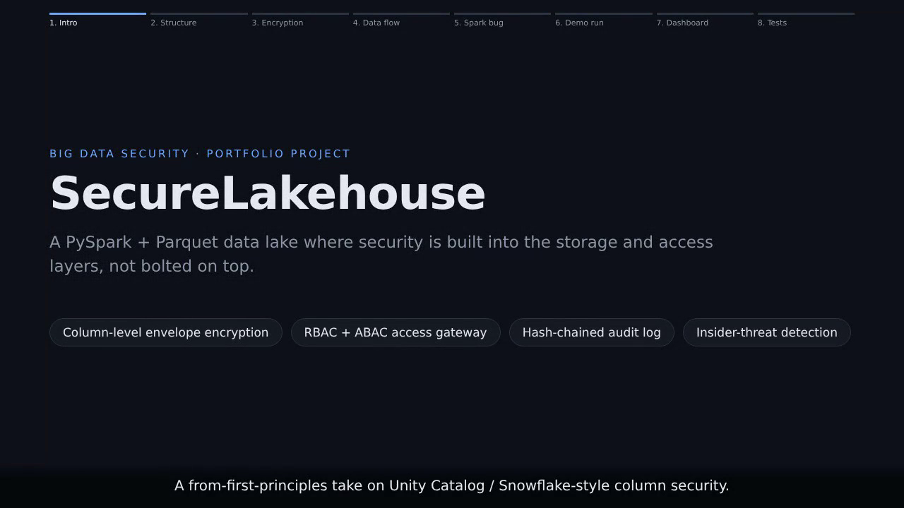

# SecureLakehouse

A PySpark + Parquet data lake where security lives in the **storage and access
layers**, not in the UI: column-level envelope encryption at rest, a hybrid
RBAC/ABAC access gateway that fails closed, a tamper-evident hash-chained audit
log, and a rule-based insider-threat detector that reads only that audit trail.

It is a from-first-principles take on what Databricks Unity Catalog or Snowflake
column-level security and row access policies provide, written so that every
mechanism can be seen, tested and explained. It runs fully offline on one machine.

> Portfolio / learning project. It is not production software; read
> [docs/threat-model.md](docs/threat-model.md) for what it does **not** defend against.

## Why big data + security together?

Big-data platforms concentrate an organisation's most sensitive data in one place
and make bulk reads cheap. Distributed execution also creates failure modes that
single-process security code never meets. This project's central bug is one of
them: a key manager that works perfectly in a unit test **silently corrupts
encryption** once Spark runs it on executors. Security mechanisms have to be
designed *for* the execution engine, not added on top of it.

## Architecture

```
                    data/raw/employees.csv
                              │
                              ▼
 ┌──────────────────── pipeline/ingest.py (driver) ─────────────────────┐
 │ 1. KeyManager.export_key_material(create_missing=True)               │
 │    - mints + wraps + persists any missing DEK ONCE, on the driver    │
 │ 2. sc.broadcast({col: {version, key_bytes}})   (immutable bytes)     │
 │ 3. UDF: encrypt_with_key(broadcast_bytes, cell)   (pure function)    │
 └──────────────────────────────┬───────────────────────────────────────┘
                                ▼
   lake/*.parquet   employee_id, department  (plaintext, filterable)
                    name_enc,  name_kv       (Fernet ciphertext, key version)
                    email_enc, email_kv, ssn_enc, ssn_kv, salary_enc, salary_kv
   state/keystore.json   PBKDF2 salt + iterations, WRAPPED DEKs only

   Subject(user, role, department)   ← assumed to come from an IdP (out of scope)
          │ columns, filters
          ▼
 ┌──────────────────── pipeline/gateway.py (only read path) ────────────┐
 │ a. filters only on plaintext columns the caller may read             │
 │ b. ABAC row filters (department scoping) → count rows                │
 │ c. security/policy.py: decide(subject, col, count) per column        │
 │ d. ANY DENY → refuse whole query (fail closed)                       │
 │ e. ALLOW → broadcast keys for ALLOWed cols only → decrypt UDF        │
 │    MASK  → constant "***REDACTED***" (no key is ever touched)        │
 │ f. exactly ONE audit event (served / masked / denied / error)        │
 └───────────────┬──────────────────────────────────────────────────────┘
                 ▼
   state/audit.jsonl   seq, ts, user, role, columns, decisions, outcome,
                       row_count, requested_row_count, prev_hash, hash
                 │                                 │
                 ▼                                 ▼
   security/audit.py verify()            security/anomaly.py detect()
   (SHA-256 hash chain walk)             VOLUME_SPIKE · NEW_SENSITIVE_COLUMN
                                         DENY_BURST · OFF_HOURS
                 ▲                                 ▲
                 └──── cli.py · demo/run_demo.py · app.py (presentation only)
```

Details per module are in [docs/architecture.md](docs/architecture.md).

## Demo video

[](docs/media/securelakehouse-demo.mp4)

[`docs/media/securelakehouse-demo.mp4`](docs/media/securelakehouse-demo.mp4) is a 3 min 51 s
walkthrough with captions and no audio. It has eight chapters:
1. intro
2. project structure
3. envelope encryption, including what raw Parquet and the keystore actually contain
4. the write, read and oversight data flow
5. the Spark executor-isolation bug and its fix
6. the real output of `demo/run_demo.py`
7. the live Streamlit dashboard: roles, breach replay, alerts, and tampering caught
8. test results

Nothing in it is mocked. Numbers and terminal output come from a real run, and
the dashboard segment is a recorded browser session. Regenerate it with
`bash demo/video/make_video.sh`, which needs Node with Playwright, and ffmpeg.

## Quick start

Requirements: Python 3.10+ and a Java runtime (JDK 17 or 21) for Spark. Tested
here on Python 3.10.20 and 3.13 with PySpark 4.3.0, OpenJDK 21.

```bash
python -m venv .venv
```

```bash
source .venv/bin/activate
```

```bash
pip install -r requirements.txt
```

The master key is derived from a passphrase that is read from the environment and
never stored:

```bash
export SECURELAKEHOUSE_PASSPHRASE='pick-something-long'
```

### 1. Narrated end-to-end demo

```bash
python demo/run_demo.py
```

The demo ingests the sample CSV, runs a legitimate workday for four roles, then
simulates a compromised analyst account. It shows the gateway blocking that
account at several points, runs the detector, and finally tampers with the audit
log to show `verify()` catching it. Output goes to `./demo_output/`, which is
recreated on every run. (If the variable is unset, the demo alone falls back to a
throwaway passphrase, because its keystore is wiped on every run anyway.)

### 2. CLI

```bash
python cli.py ingest --csv data/raw/employees.csv --lake lake
```

```bash
python cli.py query --lake lake --user sam.analyst --role analyst --department Engineering --columns employee_id,name,salary
```

```bash
python cli.py query --lake lake --user taylor.support --role support --department HR --columns employee_id,name,email,ssn --filter employee_id=E007
```

```bash
python cli.py audit-verify
```

```bash
python cli.py detect
```

To replay the demo's exact scenario through the CLI (this wipes `./lake` and
`./state`), then inspect it:

```bash
python cli.py scenario
```

Other commands: `rotate-key --column ssn`, `ingest --mode append`, `detect --json`.
State (keystore + audit log) lives in `./state` unless you pass `--state-dir`.
Exit codes: `0` ok, `3` query denied, `4` audit chain tampered.

`audit-verify` and `detect` need neither the passphrase nor Spark. They read only
the audit log, so a monitoring job can run them with far less privilege than the
data has.

### 3. Streamlit dashboard (optional)

```bash
streamlit run app.py
```

Click **Reset workspace & ingest sample CSV** in the sidebar, then pick a role and
run queries. You can also replay the breach simulation, watch the audit log and
colour-coded alerts update, and use **Simulate tampering** then **Verify
integrity**. The app keeps its own workspace in `./app_workspace/`.

**`app.py` is a presentation layer only.** It calls the same `SecureGateway`,
`AuditLog` and `anomaly.detect()` as the CLI, wired by the same
`open_lakehouse()`. It never reads Parquet, touches keys or makes an access
decision itself; deleting it changes no security property.

### 4. Tests

```bash
python -m pytest
```

107 tests (80 test functions, some parametrised) cover crypto, policy, audit,
anomaly rules, the CLI, the Spark key-isolation bug, and end-to-end properties,
including a direct byte-level and decoded-value scan of the Parquet files for
plaintext. All pass with no network access. The suite was run inside a network
namespace with only loopback up (Spark's Python↔JVM bridge needs loopback). See
[docs/test-cases.md](docs/test-cases.md).

## Project structure

```
security/            no Spark dependency; every mechanism unit-testable alone
  crypto.py          PBKDF2 KEK, per-column versioned DEKs, wrapping, rotation,
                     pure encrypt/decrypt primitives for executors
  policy.py          RBAC + ABAC engine (ALLOW / MASK / DENY, default-deny)
  audit.py           SHA-256 hash-chained JSON-lines audit log
  anomaly.py         four explainable insider-threat rules
pipeline/
  spark_session.py   shared local SparkSession ("securelakehouse")
  ingest.py          CSV -> encrypted Parquet (broadcast-safe)
  gateway.py         SecureGateway: the only supported read path
  context.py         open_lakehouse(): single wiring point for all entry points
demo/
  run_demo.py        narrated end-to-end story
  video/             demo-video generator (storyboard + Playwright recorder)
  scenario.py        scripted workday + breach, simulated clock, tamper helper
  render.py          text tables/banners
data/raw/employees.csv   12 clearly fake employees (9xx SSNs, example.com)
cli.py               ingest / query / rotate-key / audit-verify / detect / scenario
app.py               Streamlit dashboard (presentation only)
tests/               pytest suite
docs/                architecture, threat model, test cases, CV/portfolio notes
```

## Design decisions (the interview version)

### 1. The Spark executor-isolation bug, and the broadcast fix

**The naive design.** You write a `KeyManager` that lazily creates a column's
key on first use, then wrap `km.encrypt_value` in a Spark UDF. It passes every
unit test, because there is only one process.

**What actually happens.** A UDF closure is pickled and shipped *per task*, and
Python UDFs run in separate worker processes even in `local[*]` mode. Each task
unpickles its own copy of the KeyManager, finds no key for `ssn`, **mints its own
random DEK**, labels it "version 1", and writes the keystore. Last writer wins.
The job succeeds and nothing errors, but rows from every other partition are
encrypted under keys that no longer exist anywhere. The driver's own KeyManager
object never even saw a key being created.

**Measured, not assumed.** `tests/test_spark_key_isolation.py` reproduces it with
a deliberately picklable KeyManager. With 40 rows in 8 partitions, six standalone
runs each left **35–36 of 40 rows permanently undecryptable**: only the partition
whose key won the race survived. This is silent data loss, and it is worse than a crash.

**The fix.** No mutable state may cross the driver/executor boundary.
1. On the driver, `export_key_material(create_missing=True)` creates and persists
   any missing key **once**, centrally.
2. Only immutable `bytes` are shipped, via `SparkContext.broadcast` (sent to each
   executor once, not once per task).
3. The UDF calls the pure function `encrypt_with_key(key_bytes, value)`.

As a guardrail, `KeyManager.__reduce__` raises `TypeError`, so the naive version
can no longer be written by accident. The read path ships keys **only for ALLOWed
columns**, and the broadcast is `destroy()`ed once results are collected.

**A second executor bug, found while running the demo.** UDFs reference
`security.crypto` *by module name*: cloudpickle does not ship module source. The
demo inserts the project root into `sys.path`, but that only affects the driver
process. Run from any other directory, executors failed with
`ModuleNotFoundError: No module named 'security'`. Same lesson: driver state
(here, `sys.path`) is not executor state. The fix in `spark_session.py` puts the
project root on `PYTHONPATH` *before* the JVM starts, because the workers inherit
it from the JVM's environment. It is also set as `spark.executorEnv.PYTHONPATH`.

### 2. Envelope encryption (KEK → DEK)
- **Rotating the master key** only re-wraps the small DEKs; the data is not
  re-encrypted. A per-column DEK limits the damage of one leaked key to one column.
- The keystore stores **only wrapped DEKs**, plus the PBKDF2 salt and iteration
  count (600,000, the OWASP 2023 value for PBKDF2-HMAC-SHA256). A `kek_check`
  token turns a wrong passphrase into an immediate `PermissionError`.
- **Versioned keys**: every cell has a `<col>_kv`. Rotation adds a version and
  never deletes one, so old rows stay readable and new writes use the new key. This
  is tested end to end with rotate → append ingest → read both versions.
- **Fernet** (AES-128-CBC + HMAC-SHA256, random IV) is *authenticated*, so a
  modified ciphertext raises instead of decrypting to garbage. It is also
  *randomized*: equal values encrypt differently, so there is no equality leakage.
  The cost is that you cannot filter or join on encrypted columns. That is why
  `employee_id` and `department` stay plaintext.
- Atomic keystore writes (temp file, then `fsync`, then `os.replace`): a crash
  mid-write must never brick the lake.

### 3. Access control: fail closed, at the column level
- **Default-deny**: a column without a rule, an unknown role, or a request for
  the physical `ssn_enc` column is DENY.
- **One DENY refuses the whole query.** Returning the allowed columns would let a
  caller map the schema and its sensitivities by probing.
- **ABAC applies only where plaintext would be revealed.** Department scoping and
  the row cap act on ALLOW decisions for non-privileged roles. A MASKed value
  reveals nothing, so capping it protects nothing. `admin` is privileged, but it
  is still audited and still watched by the detector.
- **Masking is a constant** (`***REDACTED***`), not `***-**-1234`. It leaks
  nothing, not even the length, and no key is touched to produce it.
- **Filters** may only use plaintext columns the caller is allowed to read.
  Otherwise `WHERE ssn = '…'` would be an oracle.

### 4. Tamper-evident audit
A SHA-256 hash chain: `hash = SHA256(canonical_json(entry incl. prev_hash))`. Each
entry has three independent checks (contiguous `seq`, `prev_hash` link, own
hash), so `verify()` names the first broken entry. Canonical JSON (sorted keys,
no whitespace) makes hashing deterministic. The detector uses
`requested_row_count` as well as `row_count`, so a *denied* bulk export still
shows up as a volume spike.

### 5. Rules, not ML
Every alert is a sentence an investigator can check against the log, for example
"requested 12 rows; their last 4 queries averaged 4.0 rows (stdev 0.0),
threshold 8.0". Baselines use only *prior* events per user. The volume threshold
is `max(mean + 3σ, 2 × mean)`: with a perfectly consistent user σ = 0, so without
the 2× floor a 4 → 5 row change would fire.

## Limitations (honest list)

- **No authentication.** `Subject` attributes are trusted as given; a real system
  would take them from an identity provider.
- **Hash chain without an external anchor.** An attacker who can rewrite the
  whole file can recompute every hash, and dropping the newest entries is
  undetectable. `head_hash()` is there to be anchored in a write-once store; this
  project does not do that anchoring.
- **The KEK comes from a passphrase.** Production would use a KMS/HSM so the
  KEK never exists in application memory.
- **Spark executors are inside the trust boundary.** Broadcast DEK bytes are in
  executor memory during a query.
- **Ciphertexts are not bound to their row.** Someone with write access to the
  Parquet files could swap two employees' `salary_enc` values undetected.
  Cross-column swaps fail, because each column has its own key. AES-GCM with the
  row id as associated data would fix this.
- NULLs stay NULL, which leaks *which* cells are empty. A denial reason includes
  the would-be row count.
- Results are collected to the driver (fine for a demo, not for TB-scale exports).
- Rule-based detection can be evaded by an attacker who knows the thresholds.
  Working hours are evaluated in UTC.
- Single-writer audit log: there is no file locking for concurrent gateways.

Full discussion: [docs/threat-model.md](docs/threat-model.md).

## Documentation
- [docs/architecture.md](docs/architecture.md): module-by-module data flow
- [docs/threat-model.md](docs/threat-model.md): what is defended, and what is not
- [docs/test-cases.md](docs/test-cases.md): every test and what it proves
- [docs/cv-and-portfolio.md](docs/cv-and-portfolio.md): CV bullets, SoP paragraph, portfolio outline
